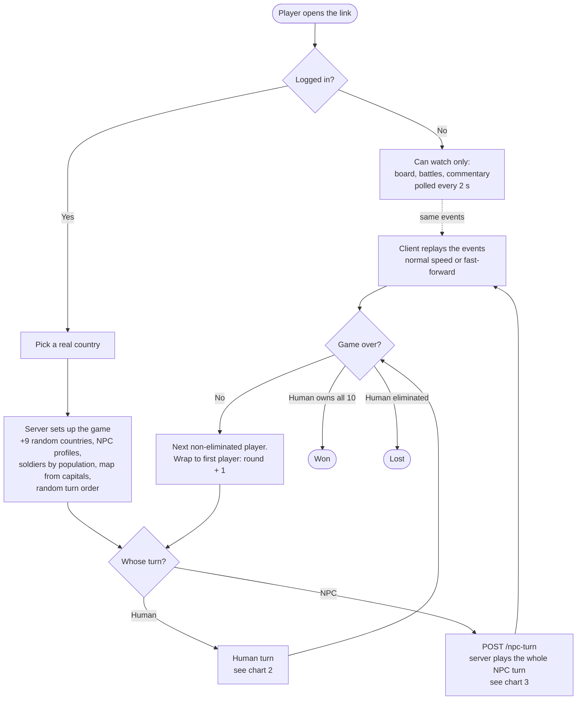
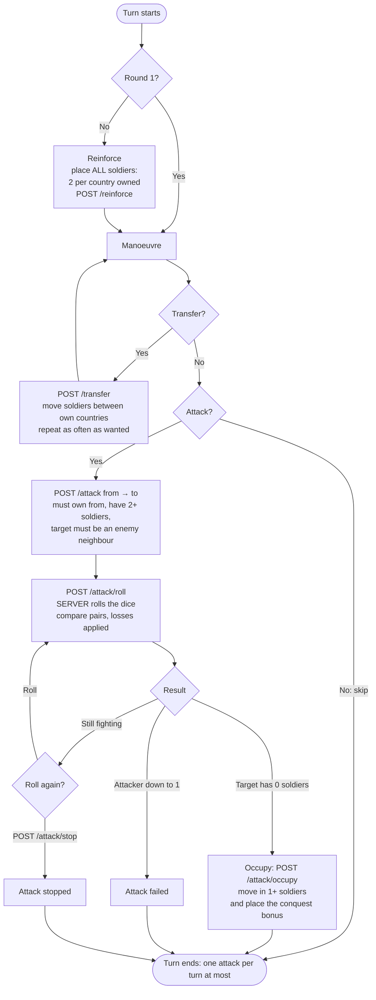
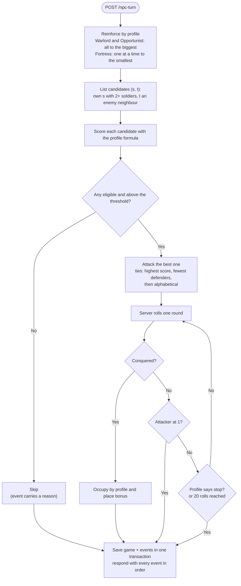
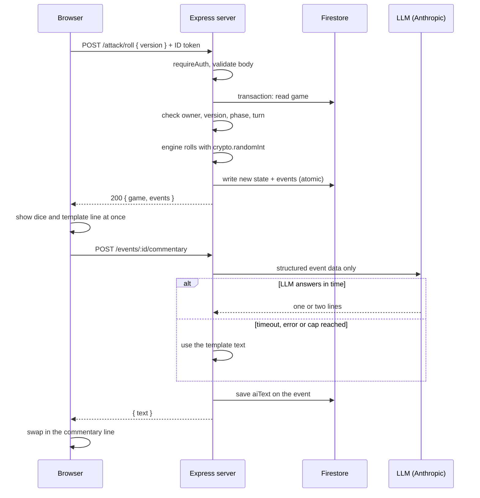

# How Geopolitics works: flow charts

Built from `GAME_RULES.md` (§3, §4, §5, §8, §9) and `ARCHITECTURE.md` (§3, §4). If they disagree with this file, they win.

## 1. The whole game

## 2. The human's turn (one phase per request)

Every action sends the `version` it last saw. A stale version gets a 409, so a double click cannot roll twice.

## 3. An NPC's turn (all inside one server request)

The LLM is never called here, so the request stays short.

## 4. A dice roll and its commentary

The LLM only writes words for an event the engine already produced. It decides nothing.
